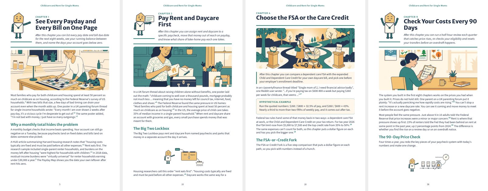

# PocketForge

**Turn a skill or niche into a sourced, illustrated ebook you can sell.** PocketForge is an agent pipeline: it researches a niche, ranks 20 "profitable pockets", writes every chapter with real footnoted sources, designs an original mascot, and exports a print-ready PDF, a Kindle EPUB, a KDP paperback (interior + wrap cover), a printable worksheet pack, store listing images and mascot animations.

It runs inside your AI coding agent. There is no separate app, no API key and no hosted service.

| Works with | How |
|---|---|
| **Claude Code** (CLI, desktop, VS Code, JetBrains) | Native plugin: slash commands, 11 subagents, 3 skills, auto-run quality gates |
| **Google Antigravity** | `AGENTS.md` + `.agent/rules` + `.agent/workflows` (`/forge`, `/book`, ...) |
| **Cursor** | `AGENTS.md` + `.cursor/rules/pocketforge.mdc` |
| **OpenAI Codex CLI** | `AGENTS.md` |
| **Gemini CLI** | `GEMINI.md` (imports `AGENTS.md`) |
| **GitHub Copilot (agent mode)** | `.github/copilot-instructions.md` |
| **Windsurf** | `.windsurf/rules` + `AGENTS.md` |
| Others (Amp, Jules, Cline, Roo, ...) | Point them at `AGENTS.md` |

<p align="center">
  
  
</p>



*Example output: "Childcare and Rent for Single Moms" (45 pages, 49 sourced endnotes, 9 worksheets), built end to end with PocketForge.*

---

## What you get per book

```
projects/<slug>/output/
  ebook.pdf                 # 5.625 x 9 in ebook with cover, TOC, worksheets, endnotes
  ebook.epub                # reflowable EPUB 3 for Kindle / Apple / Kobo
  paperback-interior.pdf    # 6 x 9 in KDP interior (no cover)
  paperback-cover.pdf       # KDP wrap cover: back + spine + front with bleed
  worksheet-pack.pdf        # US Letter printables, one worksheet per page
  cover.png  mockup.png  listing-1..3.png
  anim/*.mp4  anim/*.gif    # mascot idle, wave, explainers, 30 s promo
  PUBLISHING.md / README.md # blurb, keywords, price suggestion
```

## How it works

```
skill seed → research → gap mining → 20 ranked pockets ⏸ → transformation map → benchmark
→ outline ⏸ → manuscript (writer + fresh critic + gates) → mascot sheet ⏸ → poses & scenes
→ animations → brand + 3 covers ⏸ → layout → PDF / EPUB / paperback / extras
```

⏸ = hard stop. The agent waits for you to pick a pocket, approve the outline, approve the mascot and choose a cover.

**Built-in honesty rules**

- No invented stats, quotes, testimonials or credentials. Every stat carries a `[^n]` footnote that must resolve to a saved source file (`Source: <URL> | Fetched: <date>`).
- Three gates run on every chapter: **citations** (every footnote resolves), **banned phrases** (no "delve", "unlock", "game-changer", ...) and **structure** (opener, worksheet, endnotes).
- A fresh critic reviews each chapter. The writer never grades its own work.
- Finance, health and legal books get a disclaimer page automatically.

## Requirements

| Tool | Needed for | Required? |
|---|---|---|
| Node.js 18+ | gates, layout, rendering | yes |
| Python 3.9+ with `pillow`, `pypdf`, `pymupdf` | EPUB build, PDF checks | yes |
| Google Chrome or `npx playwright install chromium` | PDF and image rendering | yes |
| [Firecrawl MCP](https://github.com/mendableai/firecrawl-mcp-server) | web research | yes (or swap in your agent's own search/scrape tool) |
| Canva MCP connector | cover/brand designs | optional, with an HTML fallback |
| [Higgsfield CLI](https://github.com/higgsfield-ai/cli) | AI cover art, chapter illustrations, promo art | optional |

Everything installs locally (`npm install`). Nothing global.

---

## Install

### Claude Code (recommended): plugin

```bash
# inside Claude Code
/plugin marketplace add AyushDas4890/pocketforge
/plugin install pocketforge@pocketforge
```

Then, in an empty folder where your books will live:

```
/pocketforge:setup
/pocketforge:forge "personal finance for nurses"
```

`/pocketforge:forge "AUTO"` lets it pick a seed from research.

| Command | Does |
|---|---|
| `/pocketforge:setup` | Copies scripts, rules and `package.json` into the folder, installs local deps, runs tests |
| `/pocketforge:forge "<skill or AUTO>"` | Full pipeline with 4 approval stops |
| `/pocketforge:pockets "<seed>"` | Research + 20 ranked pockets only |
| `/pocketforge:book <slug>` | Resume from an approved outline |
| `/pocketforge:animate <slug>` | Rebuild mascot animations only |

**Without the marketplace:** clone the repo, then:

```bash
git clone https://github.com/AyushDas4890/pocketforge
cd pocketforge && npm install
claude --plugin-dir .
```

### Google Antigravity

```bash
git clone https://github.com/AyushDas4890/pocketforge
cd pocketforge && npm install && pip install pillow pypdf pymupdf
```

Open the folder in Antigravity. The agent picks up `AGENTS.md` and `.agent/rules/pocketforge.md`. Run the workflows `/forge`, `/pockets`, `/book` or `/animate`, or just ask: *"Run the PocketForge forge pipeline for 'meal prep for shift workers'."* Add the Firecrawl MCP server in Antigravity's MCP settings for research.

### Cursor

Clone and install as above, then open the folder. `.cursor/rules/pocketforge.mdc` is always applied. In Agent mode, ask: *"Follow commands/forge.md for the seed 'budgeting for freelancers'."* Add Firecrawl under **Settings → MCP**.

### OpenAI Codex CLI / Gemini CLI / Copilot / Windsurf

Clone and install as above, start your agent in the folder and ask it to follow `commands/forge.md`. Codex reads `AGENTS.md`, Gemini CLI reads `GEMINI.md`, Copilot reads `.github/copilot-instructions.md` and Windsurf reads `.windsurf/rules`.

> **Non-Claude agents:** there are no automatic hooks, so the agent must run `node scripts/gates/run-all.mjs projects/<slug>/manuscript/chNN.md` after each chapter edit (AGENTS.md tells it to). Agents without subagents should review each chapter in a **new chat**, so the critic stays independent.

---

## Build commands

Run any step by hand once a project has a manuscript:

```bash
P=projects/<slug>
node scripts/layout/html-to-pdf.mjs $P                                    # ebook.pdf
NO_COVER=1 PAGE_W_IN=6 PDF_OUT=paperback-interior.pdf node scripts/layout/html-to-pdf.mjs $P
node scripts/layout/paperback-cover.mjs $P <page-count> color             # KDP wrap cover
python scripts/layout/build-epub.py $P                                    # ebook.epub
node scripts/extras/worksheet-pack.mjs $P                                 # printables
node scripts/extras/build-extras.mjs $P                                   # mockup + listing images
node scripts/extras/hf-art.mjs $P && node scripts/layout/compose-cover.mjs $P   # optional Higgsfield art + cover
npm test                                                                  # gate tests
```

Per-book metadata (title, subtitle, author, mascot, blurb, listing copy, art prompts) lives in `projects/<slug>/book.json`. Copy [`templates/project/book.example.json`](templates/project/book.example.json) to start.

## Repo layout

```
.claude-plugin/   plugin.json + marketplace.json (Claude Code)
agents/           11 role playbooks (researcher, writer, critic, character-designer, ...)
commands/         forge, pockets, book, animate, setup
skills/           anti-slop-writing, ebook-structure, mascot-rig
hooks/            runs the gates after every chapter edit (Claude Code)
scripts/          gates/, layout/, character/, figures/, extras/, lib/
templates/        CLAUDE.md rule book + book.example.json
AGENTS.md  GEMINI.md  .cursor/  .agent/  .windsurf/  .github/   other agents
```

## Publishing your book

PocketForge makes the files. Accounts, tax forms, uploads and pricing are yours: Payhip, Gumroad, Etsy, Amazon KDP and so on. Each project's `output/PUBLISHING.md` has listing copy, keywords and an upload checklist. Check each store's current rules, and the license terms of any Canva, Higgsfield or stock assets you used, before you sell.

## FAQ

**Does it need an Anthropic or OpenAI API key?** No. It runs inside whichever agent you already use.

**Can I change the page count, trim size or fonts?** Yes. Use the env vars `PAGE_W_IN` and `BOOK_FONT_PT`, the palette and fonts in each project's `brand.md`, and the rules in `templates/CLAUDE.md`.

**Can I use my own search tool instead of Firecrawl?** Yes, as long as every research file still starts with `Source: <URL> | Fetched: <YYYY-MM-DD>`. The citations gate depends on that line.

**Is the mascot safe to sell?** It is drawn from code as an original character, and the rules forbid resemblance to existing characters or brands. Still check it yourself.

## Contributing

Issues and PRs are welcome. Run `npm test` before you open a PR.

## License

MIT. See [LICENSE](LICENSE). You own the books you make with it.
